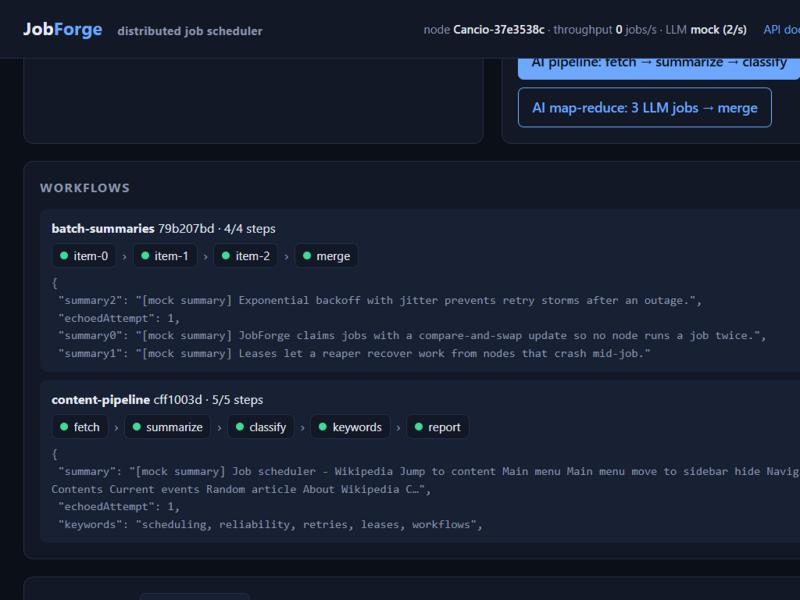
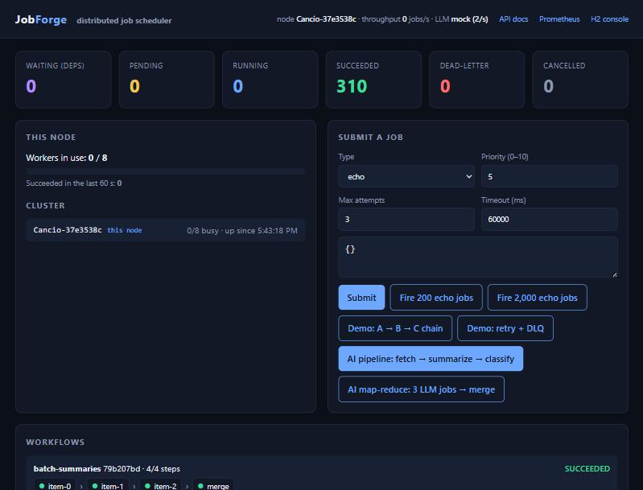

# JobForge

**A distributed, fault-tolerant orchestration engine for AI workflows, in Java 17 / Spring Boot 3.**

LLM pipelines fail in boring ways: rate limits, timeouts, a flaky step in the middle of a chain,
a worker that dies holding the job. JobForge is the execution layer underneath them. You submit a
workflow as a DAG document, step outputs flow into the next step's prompt through templates,
independent steps run in parallel across any number of nodes, and the engine handles retries with
backoff, per-type rate limits, dead-lettering, crash recovery and full per-attempt visibility.

It is also a general-purpose job scheduler: anything that implements one interface is a job type.





| | |
|---|---|
| **Stack** | Java 17, Spring Boot 3.5, Spring Data JPA, PostgreSQL / H2, Anthropic Java SDK, Micrometer + Prometheus, springdoc OpenAPI, JUnit 5, Mockito, Awaitility, JaCoCo, Docker, GitHub Actions |
| **Tests** | 66 unit and integration tests, 83 % line coverage, including a 12-thread claim race test proving no job is ever claimed twice |
| **Throughput** | 472 jobs/s on one node with 8 workers against a file-backed H2 database (5,000 jobs drained in 10.6 s on a laptop) |
| **Live demo** | see [docs/DEPLOY.md](docs/DEPLOY.md) for the free Render + Neon setup |

---

## What it does

**AI workflows**
- **Workflows as a DAG document.** `POST /api/v1/workflows` with named steps and `dependsOn`; the engine validates ids, rejects cycles, and creates the jobs in one transaction.
- **Outputs flow between steps.** `{{steps.fetch.output.text}}` in any payload string is resolved from the upstream step's result right before the step runs. Whole-string references keep their type (numbers, lists, objects).
- **LLM job type** backed by the official Anthropic Java SDK, with a pluggable provider interface and a zero-cost deterministic mock used automatically when no API key is set (tests, CI, public demos).
- **Per-type rate limits** (token bucket) so LLM steps stay under provider quotas. A throttled job is not claimed and stays queued, so limits never lose work.
- **Ready-made pipelines** for the dashboard and docs: fetch → summarise → classify ∥ keywords → report, and a map-reduce (N LLM jobs in parallel → merge).

**Reliable execution**
- **At-least-once execution with leases.** A claimed job carries `lease_owner` / `lease_until`. Workers heartbeat to extend the lease; a reaper on every node hands back any job whose lease expired, so a crashed or hung node never loses work.
- **Lock-free, multi-node safe claiming.** Claims are one conditional `UPDATE … WHERE id = ? AND version = ? AND status = 'PENDING'`. The database serialises row writes, so exactly one of N racing nodes wins. Works on H2, PostgreSQL and MySQL without advisory locks or `SKIP LOCKED`.
- **Retries with exponential backoff and jitter**, then a **dead-letter queue** with one-click operator retry.
- **Dependencies with transitive cancellation.** A step waits until every upstream step succeeded; if one dies or is cancelled, the whole downstream chain is cancelled.
- **Priorities, delayed jobs, cron schedules, per-job timeouts** (enforced by interrupting the handler), **idempotent submission** (safe under concurrent duplicates), **webhooks** after commit.

**Operations**
- Live dashboard with workflow progress, OpenAPI/Swagger UI, Prometheus metrics (job duration p50/p95/p99 by type and outcome, retries, reclaimed leases, worker utilisation), per-attempt execution history with the node that ran it, pause/resume a node for draining, cluster membership via heartbeats.

## Architecture

```
  POST /api/v1/workflows  ──►  WorkflowService: validate DAG, topological order, 1 transaction
  POST /api/v1/jobs       ──►  JobService: idempotency, validation, dependency checks
                                              │
                                              ▼
                               ┌──────────────────────────────┐
                               │  jobs table (any SQL DB)     │
                               │  status · run_at · priority  │
                               │  lease_owner · lease_until   │
                               │  version (CAS) · attempts    │
                               │  workflow_id · step_id       │
                               └──────────────┬───────────────┘
                                              │
   ┌──────────────────────── node 1 ──────────┼─────┐        ┌── node 2 ──┐
   │ JobDispatcher (event-driven loop)        │     │◄──────►│  same code │
   │   free = workers − inFlight              │     │        └────────────┘
   │   claimBatch(free): rate limit per type, │     │
   │     then CAS UPDATE per job              │     │
   │        ▼ worker pool                     │     │
   │ JobExecutor                              │     │
   │   ├─ TemplateResolver: {{steps.x.output}}│     │
   │   ├─ handler on helper thread            │     │
   │   ├─ heartbeat every lease/3 ────────────┼─────┤
   │   ├─ timeout → interrupt                 │     │
   │   └─ JobStateService (1 tx): succeed /   │     │
   │        retry+backoff / dead; release     │     │
   │        dependents; next cron; history    │     │
   │ LeaseReaper: RUNNING ∧ lease expired →   │     │
   │        PENDING (or DEAD)                 │─────┘
   └──────────────────────────────────────────┘
        │ events ──► MetricsListener (Prometheus) · WebhookNotifier (after commit)
```

**Job lifecycle**

```
 WAITING ──(all deps succeed)──► PENDING ──(claimed)──► RUNNING ──► SUCCEEDED
    │                               ▲                      │
    │                               └──(retry w/ backoff)──┤
    │                                                      ▼
    └──(a dep dies)──► CANCELLED                          DEAD (attempts exhausted)
```

### Design decisions worth asking me about

- **Why compare-and-swap instead of `SELECT … FOR UPDATE SKIP LOCKED`?** Portability and simplicity. The CAS claim is one short transaction per job, holds no lock while scanning candidates, and behaves identically on every SQL database. Over-fetching 3× the free slots means losing a few races still fills a node in one pass.
- **Why is the dispatcher event-driven?** A pure polling loop caps throughput at `workers / pollInterval` (8 workers at 500 ms = 16 jobs/s). JobForge's loop wakes the instant a worker finishes and claims again, so throughput is bounded by the database, not the timer. Measured: 16 → 472 jobs/s on the same hardware.
- **Why rate-limit at claim time?** A throttled job simply is not claimed this cycle; no worker thread sits idle holding it and nothing is dropped. The limit is per node by design (no shared counter); with N nodes the cluster-wide rate is N× the setting.
- **Why resolve templates at run time, not at submission?** Upstream outputs do not exist yet when the workflow is submitted. Resolving just before execution, from the persisted result of a step that has `SUCCEEDED`, means a step never sees a partial result. Referencing a step that is not a declared dependency fails that step with a clear message.
- **Why at-least-once?** Exactly-once is impossible without cooperation from the handler. JobForge guarantees a job is never *claimed* twice concurrently and never *lost*; handlers are documented to be idempotent for the crash-after-side-effect case. Stale results from a reaped worker are rejected because the completing transaction sees the job is no longer `RUNNING`.

## Quick start

Requires Java 17+ and Maven. No database setup: the default profile uses file-backed H2.
No API key needed: the LLM steps use the built-in mock until `ANTHROPIC_API_KEY` is set.

```bash
mvn spring-boot:run
```

| URL | What |
|---|---|
| http://localhost:8080 | Dashboard: workflows, queue depth, worker utilisation, cluster nodes, demo buttons |
| http://localhost:8080/swagger-ui.html | Interactive API docs |
| http://localhost:8080/actuator/prometheus | Metrics |
| http://localhost:8080/h2 | H2 console (JDBC URL `jdbc:h2:file:./data/jobforge`, user `sa`) |

Run the AI pipeline demo (fetches a page, then summarises, classifies and extracts keywords):

```bash
curl -s -X POST localhost:8080/api/v1/workflows/examples/content-pipeline \
     -H 'Content-Type: application/json' -d '{"url":"https://en.wikipedia.org/wiki/Job_scheduler"}'
```

To use real Claude output, export `ANTHROPIC_API_KEY` before starting. The default model is
`claude-opus-5-5`; override per job with `payload.model` or globally with `JOBFORGE_LLM_MODEL`.

### Two-node cluster with PostgreSQL

```bash
docker compose up --build
```

Node 1 is on http://localhost:8081 and node 2 on http://localhost:8082, sharing one PostgreSQL.
Submit to either; both drain the queue. Kill one (`docker compose kill jobforge-2`) while jobs are
running and watch the other node's reaper reclaim its expired leases.

### Benchmark

```bash
./scripts/benchmark.sh 5000          # or .\scripts\benchmark.ps1 -Count 5000 on Windows
```

```
Queued 5000 jobs in 1925 ms
Drained 5000 jobs in 10.6s  ->  472 jobs/s
```

(single node, 8 workers, H2 file database, Windows laptop; `echo` handler, so this measures the engine's claim → execute → commit overhead, not handler work.)

## Workflows

```bash
curl -X POST localhost:8080/api/v1/workflows -H 'Content-Type: application/json' -d '{
  "name": "support-triage",
  "steps": [
    { "id": "fetch",    "type": "http-get", "payload": { "url": "https://example.com/ticket/42" } },
    { "id": "summary",  "type": "llm", "dependsOn": ["fetch"],
      "payload": { "prompt": "Summarize this ticket in 2 sentences:\n\n{{steps.fetch.output.text}}", "effort": "low" } },
    { "id": "severity", "type": "llm", "dependsOn": ["summary"],
      "payload": { "prompt": "Rate severity low/medium/high, one word:\n\n{{steps.summary.output.text}}", "maxTokens": 5 } },
    { "id": "tags",     "type": "llm", "dependsOn": ["summary"],
      "payload": { "prompt": "Give 3 tags, comma separated:\n\n{{steps.summary.output.text}}", "maxTokens": 30 } },
    { "id": "notify",   "type": "echo", "dependsOn": ["severity", "tags"],
      "payload": { "severity": "{{steps.severity.output.text}}", "tags": "{{steps.tags.output.text}}" } }
  ],
  "callbackUrl": "https://example.com/hooks/jobforge"
}'
```

`severity` and `tags` run in parallel once `summary` exists; `notify` waits for both. Poll
`GET /api/v1/workflows/{id}` for per-step status, attempts and outputs, or watch the dashboard.

Template syntax: `{{steps.<id>.output}}` (whole result object) or `{{steps.<id>.output.<path>}}`
with dot paths into maps and list indexes (`tags.0`). Only steps listed in `dependsOn` are safe to
reference.

## API

| Method | Path | Purpose |
|---|---|---|
| `POST` | `/api/v1/workflows` | Submit a DAG of steps |
| `GET` | `/api/v1/workflows` · `/{id}` | Recent workflows / one workflow with every step |
| `POST` | `/api/v1/workflows/examples/content-pipeline` | Demo: fetch → summarise → classify ∥ keywords → report |
| `POST` | `/api/v1/workflows/examples/batch-summaries` | Demo: map-reduce over a list of texts |
| `POST` | `/api/v1/jobs` | Submit one job (201 new, 200 if the idempotency key was seen) |
| `POST` | `/api/v1/jobs/bulk` | Submit N identical jobs in one transaction |
| `GET` | `/api/v1/jobs?status=&type=&page=&size=` | List, newest first |
| `GET` | `/api/v1/jobs/{id}` · `/{id}/attempts` | Job detail / execution history per attempt and node |
| `POST` | `/api/v1/jobs/{id}/cancel` · `/retry` | Cancel (dependents too) / re-queue a `DEAD` or `CANCELLED` job |
| `GET` | `/api/v1/stats` · `/handlers` | Queue depth, utilisation, throughput, nodes, LLM provider, rate limits / job types |
| `POST` | `/api/v1/dispatcher/pause` · `/resume` | Drain this node without stopping it |

Errors are RFC 7807 problem details (`400` validation with per-field messages, `404`, `422` for engine rules such as unknown type, cycle, unknown dependency, or cancelling a finished job).

## Job types

| Type | Payload | Notes |
|---|---|---|
| `llm` | `prompt` (required), `system`, `model`, `maxTokens`, `effort` | Claude via the official SDK, or the mock when no key is set. Rate-limited to `jobforge.rate-limits.llm` per second per node (default 2). |
| `http-get` | `url`, `maxChars` | Returns status, body length and the page as plain text for downstream LLM steps |
| `echo` | anything | Returns the payload; used for reports, merges and benchmarks |
| `sleep` · `primes` | `ms` · `n` | I/O-bound and CPU-bound stand-ins |
| `flaky` · `fail` | `failTimes` · `message` | Demonstrate retry with backoff and dead-lettering |

### Writing a handler

```java
@Component
public class SendEmailHandler implements JobHandler {
    @Override public String type() { return "send-email"; }

    @Override
    public JobResult execute(JobContext ctx) throws Exception {
        String to = ctx.getString("to", null);
        if (to == null) throw new IllegalArgumentException("payload.to is required");
        mailer.send(to, ctx.getString("subject", ""), ctx.getString("body", ""));
        return JobResult.of(Map.of("sentTo", to, "attempt", ctx.attempt()));
    }
}
```

Throw to fail (the job is retried with backoff until `maxAttempts`); honour interruption, which is
how timeouts and cancellations reach you. Returned output is what downstream templates read.

## Configuration

All settings are environment-overridable.

| Property | Env var | Default | Meaning |
|---|---|---|---|
| `jobforge.workers` | `JOBFORGE_WORKERS` | 8 | Concurrent jobs per node |
| `jobforge.poll-interval-ms` | `JOBFORGE_POLL_INTERVAL_MS` | 500 | Idle sleep when nothing is due |
| `jobforge.lease-seconds` | `JOBFORGE_LEASE_SECONDS` | 30 | Lease length; heartbeat every third of it |
| `jobforge.reaper-interval-ms` | `JOBFORGE_REAPER_INTERVAL_MS` | 5000 | How often expired leases are reclaimed |
| `jobforge.retry-base-delay-ms` | `JOBFORGE_RETRY_BASE_DELAY_MS` | 1000 | Backoff base: `base · 2^(attempt−1)` ± 20 % |
| `jobforge.retry-max-delay-ms` | `JOBFORGE_RETRY_MAX_DELAY_MS` | 300000 | Backoff cap |
| `jobforge.default-timeout-ms` | `JOBFORGE_DEFAULT_TIMEOUT_MS` | 60000 | Per-attempt timeout if the job does not set one |
| `jobforge.default-max-attempts` | `JOBFORGE_DEFAULT_MAX_ATTEMPTS` | 3 | Attempts if the job does not set one |
| `jobforge.rate-limits.llm` | `JOBFORGE_RATE_LIMIT_LLM` | 2 | LLM jobs per second per node (add any type under `rate-limits`) |
| `jobforge.llm.provider` | `JOBFORGE_LLM_PROVIDER` | auto | `auto` (Claude if key present, else mock), `anthropic`, `mock` |
| `jobforge.llm.model` | `JOBFORGE_LLM_MODEL` | claude-opus-5-5 | Default model for `llm` jobs |
| `jobforge.llm.max-tokens-cap` | `JOBFORGE_LLM_MAX_TOKENS_CAP` | 4096 | Hard cap on output tokens any job may request |
| `jobforge.node-id` | `JOBFORGE_NODE_ID` | hostname + random | Stable node name for clusters |
| profile `postgres` | `SPRING_PROFILES_ACTIVE=postgres` | | Use PostgreSQL (`JOBFORGE_DB_URL`, `JOBFORGE_DB_USER`, `JOBFORGE_DB_PASSWORD`) |

## Testing

```bash
mvn test            # 66 tests, JaCoCo report in target/site/jacoco/index.html
```

| Suite | What it proves |
|---|---|
| `ExponentialBackoffPolicyTest` · `TokenBucketTest` | Doubling, cap, jitter bounds; refill rate and capacity |
| `JobHandlerRegistryTest` · `HttpGetJobHandlerTest` | Routing and duplicate rejection; HTML to text |
| `TemplateResolverTest` | Interpolation, typed whole-string references, nested maps/lists, clear errors for missing steps, paths and not-yet-succeeded upstreams |
| `WorkflowServiceTest` | Topological creation with resolved dependency ids; cycle, duplicate, unknown-step and unknown-type rejection |
| `JobStateServiceTest` · `JobServiceTest` (Mockito) | Every state transition and validation rule, including idempotency under a lost insert race |
| `WorkflowIT` | Outputs flow through a 4-step LLM pipeline; parallel map-reduce merges after all items; template misuse fails only that step; failed step cancels downstream; rate limiter caps LLM claims per second |
| `JobLifecycleIT` | Completion, retry with backoff, dead-letter, operator resurrect, timeout, DAG ordering, transitive cancellation, delayed jobs, priority ordering, cron rescheduling, cancel-before-run |
| `ConcurrencyIT` | 12 threads racing to claim 400 jobs claim each exactly once; a burst of 500 jobs executes exactly once each |
| `JobApiIT` (MockMvc) | HTTP contract: 201/200 idempotency, problem details, validation fields, cancel/retry round trip, filters, bulk |

CI (`.github/workflows/ci.yml`) runs the suite and builds the Docker image on every push and pull request.

## Deploying

[docs/DEPLOY.md](docs/DEPLOY.md) walks through a free deployment on Render with a Neon PostgreSQL
database using the included `render.yaml`. Leave `ANTHROPIC_API_KEY` unset on a public demo; the
mock provider shows every engine feature at zero cost.

## Project layout

```
src/main/java/com/manangupta/jobforge
├── api/            REST controllers (jobs, workflows, system), DTOs, RFC 7807 errors
├── config/         SchedulerProperties, executors, node identity, OpenAPI
├── domain/         Job, JobExecution, ClusterNode entities; JobStatus state machine
├── handler/        JobHandler SPI, registry, built-in handlers (llm, http-get, echo, …)
├── llm/            LlmClient SPI, AnthropicLlmClient (official SDK), MockLlmClient
├── ratelimit/      TokenBucket, per-type JobTypeRateLimiter
├── repository/     Spring Data repositories incl. the CAS claim and lease queries
├── retry/          BackoffPolicy, ExponentialBackoffPolicy
├── service/        JobService, JobClaimService, JobDispatcher, JobExecutor, JobStateService,
│                   LeaseReaper, ClusterRegistry, events, webhooks, metrics
└── workflow/       WorkflowService (DAG validation), TemplateResolver, ExampleWorkflows
src/main/resources/static/index.html   dashboard (vanilla JS, polls the API)
```

## Roadmap

- Cluster-wide rate limits backed by the database
- Conditional edges and fan-out over list outputs (one step per item, dynamically)
- Partitioned queues with consistent hashing for very large clusters
- Native `SKIP LOCKED` claim strategy as an optional PostgreSQL optimisation

## Author

Manan Gupta · [github.com/Manan-Gupta04](https://github.com/Manan-Gupta04) · [linkedin.com/in/manangupta7899](https://linkedin.com/in/manangupta7899)
